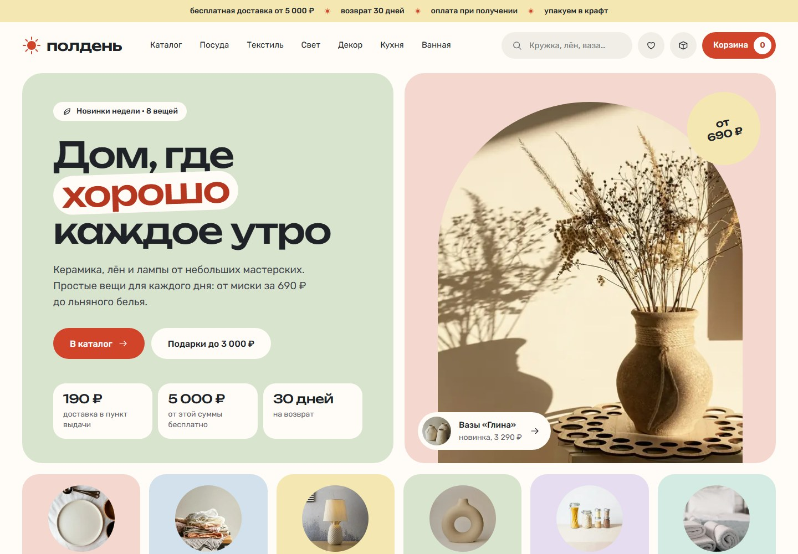
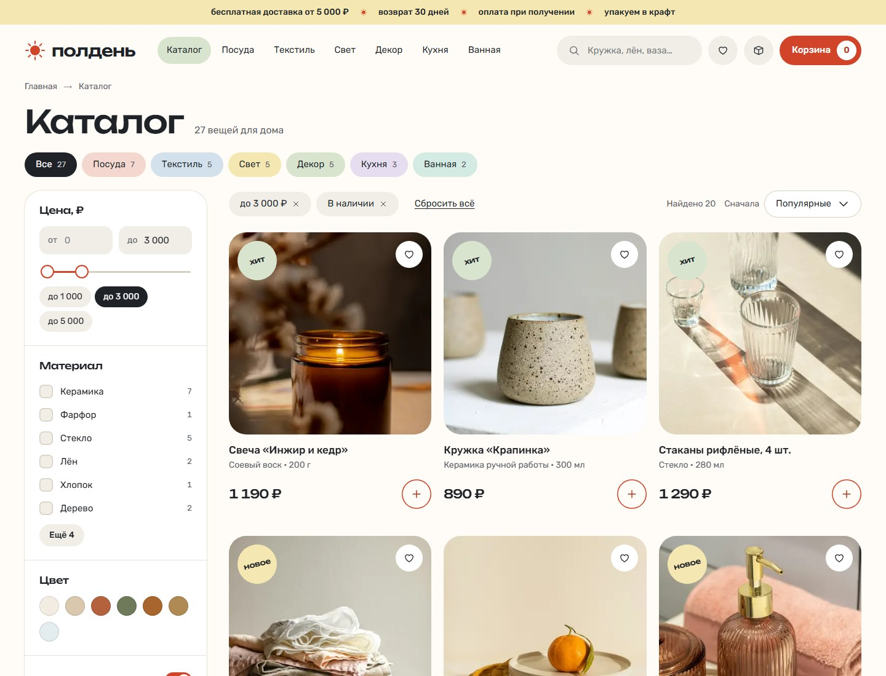
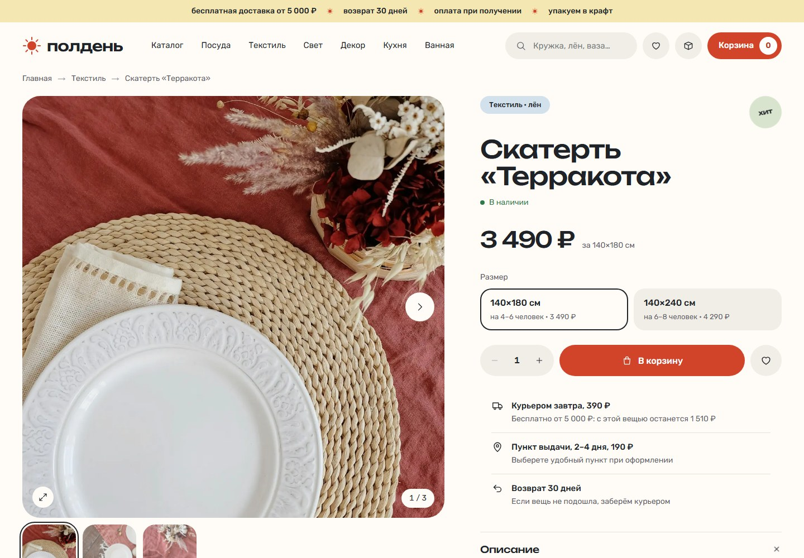
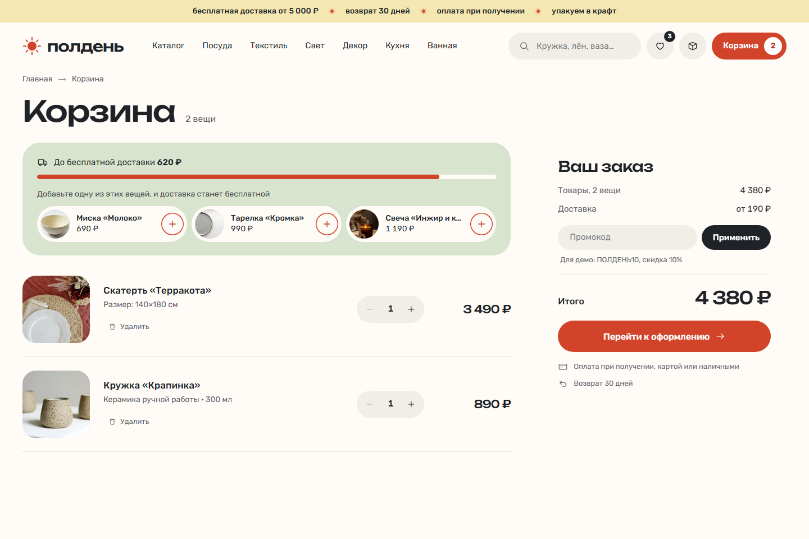
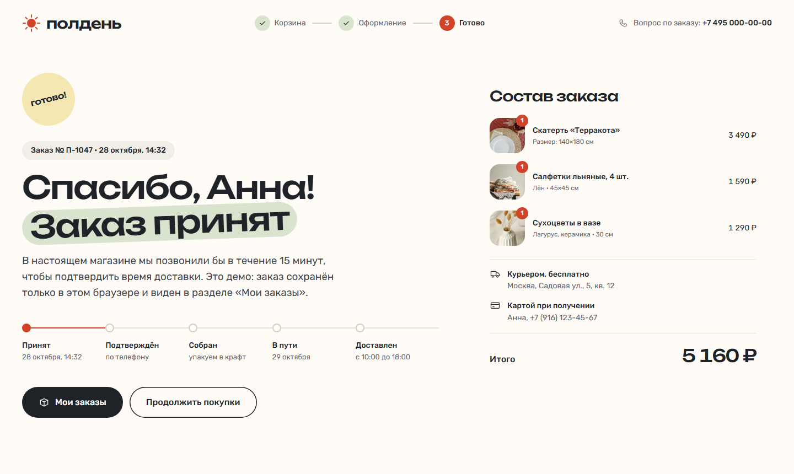
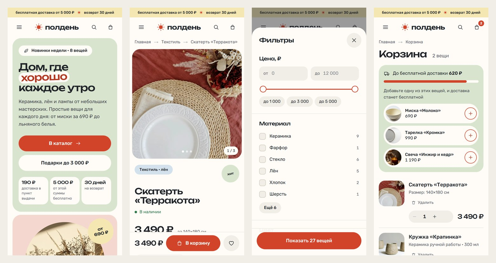

# «Полдень»: интернет-магазин товаров для дома на React

Демо-проект для портфолио. Магазин, товары, цены и телефон вымышлены, заказы никуда не отправляются,
оплаты нет: всё работает в браузере.

**Демо:** https://karelin-dev.github.io/shop-demo/



| Каталог с фильтрами | Страница товара |
|---|---|
|  |  |

| Корзина | Заказ принят |
|---|---|
|  |  |



## Что сделано

- **Дизайн с нуля.** Название, логотип (солнце в зените) и стиль «Цвет»: пастельные блоки, у каждой категории
  свой цвет, шрифты Unbounded и Rubik, круглые стикеры, фото в арке. Сначала три направления стиля на выбор,
  вёрстка повторяет выбранный макет, включая мобильную версию.
- **Многостраничный магазин на React без сервера.** React Router собирает каждую страницу в готовый HTML
  при сборке (prerender): главная, каталог и 6 категорий, 27 страниц товаров, корзина, оформление, заказы,
  избранное. После загрузки страница оживает (гидратация) и дальше работает как приложение.
  У каждой страницы свой заголовок, описание и превью для соцсетей, у товаров разметка schema.org Product,
  у каталога хлебные крошки. Есть sitemap.xml, robots.txt и страница 404.
- **Каталог.**
  - Фильтры: цена (поля, двойной ползунок, быстрые суммы), материал и цвет со счётчиками,
    «в наличии», «со скидкой», «новинки». Сортировка и поиск из шапки.
  - Фильтры хранятся в адресе страницы: подборку можно отправить ссылкой. Активные условия видны чипами,
    каждое снимается отдельно. Товары подгружаются кнопкой «Показать ещё».
  - Пустая выдача подсказывает, какое условие ослабить, и сколько вещей тогда найдётся:
    «Показать до 1 500 ₽ · 1 вещь».
  - На телефоне фильтры открываются снизу, кнопка показывает, сколько вещей найдено.
- **Страница товара.** Галерея со свайпом и просмотром на весь экран (стрелки, клавиатура), варианты размера
  и цвета (цвет меняет фото), количество, избранное, расчёт «с этой вещью до бесплатной доставки осталось…»,
  характеристики, комплект со скидкой 10%, похожие вещи и «Вы смотрели». Если товара нет: «Сообщить о поступлении».
- **Корзина.** Выезжающая мини-корзина и отдельная страница: количество, удаление с отменой, полоса
  до бесплатной доставки и недорогие вещи, которые её закрывают, промокод (в демо `ПОЛДЕНЬ10`),
  скидка за собранный комплект.
- **Оформление заказа.** Контакты с маской телефона и понятными ошибками, город, доставка курьером,
  в пункт выдачи или экспрессом (только Москва) со своей ценой, бесплатная доставка от 5 000 ₽,
  оплата при получении, подарочная упаковка. Заказ сохраняется в браузере: страница «Заказ принят»
  с этапами, раздел «Мои заказы» с повтором заказа.
- **Состояние магазина** (корзина, избранное, заказы, просмотренные) в Context и useReducer, хранится
  в `localStorage`. Расчёт корзины вынесен в чистые функции (`app/lib/cart.js`): их легко заменить запросом к API.
- **Доступность.** Окна (корзина, фильтры, меню, фото) на нативном `<dialog>`: фокус внутри окна, закрытие
  по Esc, фокус возвращается на кнопку. Подписи у полей и кнопок-иконок, ошибки формы связаны с полями,
  `aria-live` у счётчиков и уведомлений, ссылка «Перейти к содержимому», видимый фокус, контраст по WCAG AA,
  `prefers-reduced-motion`.
- **Производительность.**
  - Шрифты уменьшены до нужных символов: кириллица и цифры отдельными файлами с предзагрузкой,
    знак ₽ встроен прямо в CSS. Запасные шрифты с подобранными метриками: текст не прыгает, пока грузится шрифт.
  - Фото в WebP 400, 800 и 1200 px с `srcset`, ленивая загрузка, размеры у всех картинок,
    фото первого экрана грузится с высоким приоритетом. Второе фото в карточке грузится только при наведении,
    остальные фото галереи товара после загрузки страницы: так они не отнимают канал у главного фото.
  - Страницы с данными из браузера (корзина, заказы) заранее занимают высоту экрана, поэтому вёрстка не сдвигается.

**Lighthouse на GitHub Pages:** мобильная версия: главная 94, каталог 93, категория 93, страница товара 91
(производительность, медиана нескольких замеров), доступность, Best Practices и SEO 100 на всех этих страницах.
Десктоп: производительность 95–98, остальное 100. Корзина, оформление, заказы и избранное специально закрыты от индексации
(`noindex`), поэтому SEO у них ниже 100.

## Стек

React 19, React Router 7 (режим фреймворка, prerender без сервера), Vite 7, JavaScript, CSS Modules
и CSS-переменные, без UI-библиотек. Шрифты из Fontsource, уменьшены скриптом на Python (fonttools).
Фото подготовлены скриптом на Python (Pillow), источник Unsplash, авторы в [CREDITS.md](CREDITS.md).

## Запуск

```bash
npm install
npm run dev        # сервер разработки на http://localhost:3007/shop-demo/
npm run build      # сборка в docs/, оттуда сайт публикует GitHub Pages
npm run preview    # проверка сборки на http://localhost:3008/shop-demo/
```

Подготовка ресурсов: `npm run images` (нужна папка с исходными фото) и `python scripts/fonts.py`.

## Структура

```
app/
  root.jsx              # HTML-шаблон, шапка, подвал, мини-корзина, уведомления
  routes.js             # адреса страниц
  routes/               # главная, каталог, товар, корзина, оформление, заказ, заказы, избранное, 404
  components/           # карточка товара, фильтры, галерея, мини-корзина, шапка, подвал, сводка заказа
  data/catalog.js       # категории, товары, варианты, комплекты
  lib/
    filters.js          # фильтры, счётчики, чипы, подсказка для пустой выдачи
    cart.js             # цены вариантов, комплект, промокод, доставка
    format.js           # цены, склонения, маска телефона
    seo.js              # заголовки, описания, превью, schema.org
  shop.jsx              # состояние магазина: Context, useReducer, localStorage
  styles/               # переменные, шрифты, кнопки и поля
public/img/             # фото в WebP
scripts/                # фото, шрифты, копирование сборки в docs/, локальный сервер
docs/                   # собранный сайт для GitHub Pages
react-router.config.js  # какие страницы собирать в HTML
```

## Подключение настоящего бэкенда

Заказ собирается в `app/routes/checkout.jsx` и сохраняется функцией `placeOrder` в `app/shop.jsx`.
Чтобы отправлять его на сервер, достаточно добавить там POST-запрос с этим объектом:

```json
{
  "n": "П-1047",
  "createdAt": "2026-10-28T11:32:00.000Z",
  "items": [{ "slug": "tablecloth-terrakota", "variant": "140x180", "qty": 1, "price": 3490 }],
  "goods": 3490, "bundle": 0, "promo": "ПОЛДЕНЬ10", "promoSum": 349, "total": 3531,
  "delivery": { "method": "courier", "price": 390, "city": "Москва", "address": "Садовая ул., 5, кв. 12" },
  "payment": "Картой при получении",
  "contact": { "name": "Анна", "phone": "+7 (916) 123-45-67", "email": "" }
}
```

Каталог сейчас лежит в `app/data/catalog.js`. Его можно загружать с сервера в `clientLoader` страниц:
фильтры и расчёт корзины от этого не изменятся.

## Автор

Иван Карелин, [github.com/karelin-dev](https://github.com/karelin-dev)
